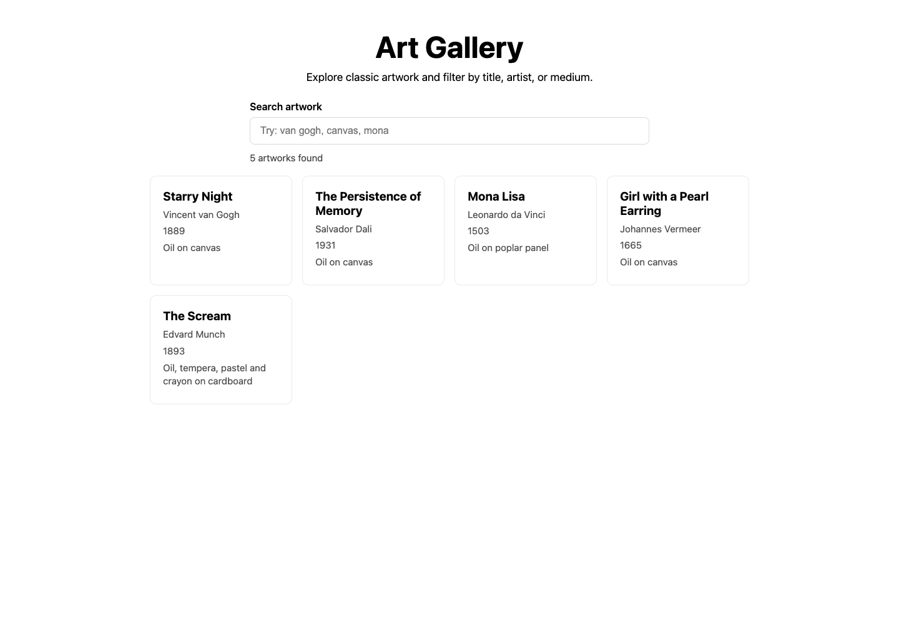

# Gallery Space

A simple Next.js gallery app with a typed API route and reusable filtering utilities.

## Local development

```bash
npm install
npm run dev
```

Open `http://localhost:3000`.

## API

`GET /api/artworks`

Supported query params:

- `search`: filters by title, artist, or medium
- `limit`: caps returned result count (default `10`, max `50`)

## Testing

Automated tests are written with Jest and cover:

- Query and limit normalization behavior
- Filtering logic edge cases
- API route method handling and response shape

Run tests with:

```bash
npm test
```

## A small, inspectable gallery

The catalog is a local dataset in `data/artworks.ts`; the API and page do not require a CMS account. `lib/artworkFilters.ts` is the shared query boundary, and the adjacent tests make it a useful starting point for a review. A preview of the artwork grid with an active search would communicate the project better than framework badges. Add loading and empty feedback before replacing the local dataset with a remote collection.

## Runtime and preview

The workspace uses Next.js 15.5.29, React 18.3.1, and the npm lockfile. The production build and eight Jest cases pass. Chrome checks cover the collection, an empty search, and restoring the collection. The unused Axios dependency was removed. Remaining advisory matches concern development tooling.



[Empty-search state](preview-empty.png)
