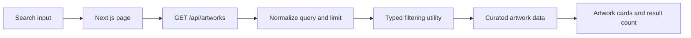

# Artwork gallery explorer

A compact Next.js and TypeScript application for browsing a curated in-repository artwork dataset. The page searches by title, artist, or medium through a typed API route and displays loading, result-count, empty, and failure states.

## Request flow



The dataset is defined in `data/artworks.ts`; the application does not call an external museum service or claim a complete catalogue. Search runs against five example works and matches case-insensitively across title, artist, and medium.

## Run locally

```bash
npm install
npm run dev
```

Open `http://localhost:3000`.

Additional commands:

```bash
npm test
npm run build
npm start
```


## API

`GET /api/artworks`

| Query parameter | Behavior |
|---|---|
| `search` | Matches title, artist, or medium; blank values return all records |
| `limit` | Positive integer, defaults to 10 and is capped at 50 |

Example:

```http
GET /api/artworks?search=canvas&limit=2
```

```json
{
  "data": [
    {
      "id": 1,
      "title": "Starry Night",
      "artist": "Vincent van Gogh",
      "year": 1889,
      "medium": "Oil on canvas"
    },
    {
      "id": 2,
      "title": "The Persistence of Memory",
      "artist": "Salvador Dali",
      "year": 1931,
      "medium": "Oil on canvas"
    }
  ],
  "total": 3,
  "returned": 2
}
```

Only `GET` is accepted; other methods return `405 Method Not Allowed` with an `Allow` header.

## Design choices

- Query and limit normalization live in pure utilities rather than the route handler.
- The API reports both total matches and returned records so clients can distinguish filtering from result limits.
- The page encodes the query before requesting the API.
- An unmounted-page guard prevents a completed request from updating abandoned component state.
- Data types are shared between the page, API, filters, and fixture dataset.

## Tests

Jest test source covers normalization and filtering edge cases, API method handling, limits, response counts, and error shape.

```bash
npm test
```

The repository currently tests utilities and the API route; it does not include a browser-level UI test.

## Repository map

```text
pages/index.tsx             Gallery and search UI
pages/api/artworks.ts       Typed API route
data/artworks.ts            Curated sample records
lib/artworkFilters.ts       Query, limit, and filtering utilities
__tests__/                  API and utility tests
styles/                     Page and global styling
```

## Scope

This is a small full-stack Next.js exercise. Images, pagination, external data synchronization, authentication, persistence, and administrative editing are intentionally outside its current scope.
