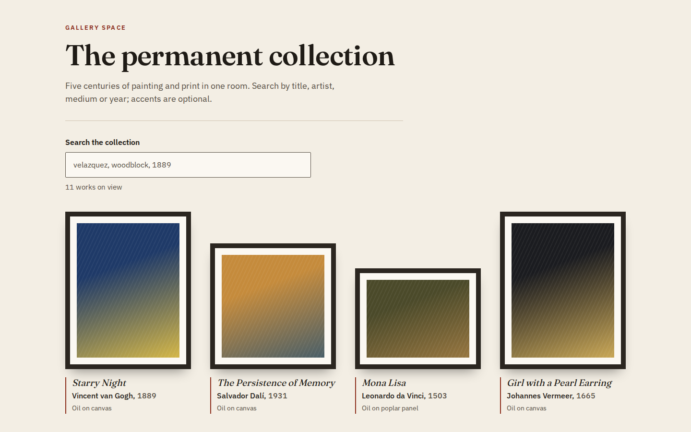
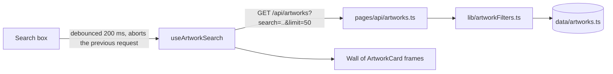
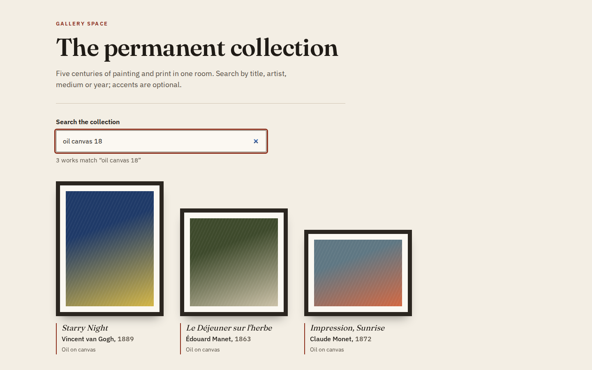
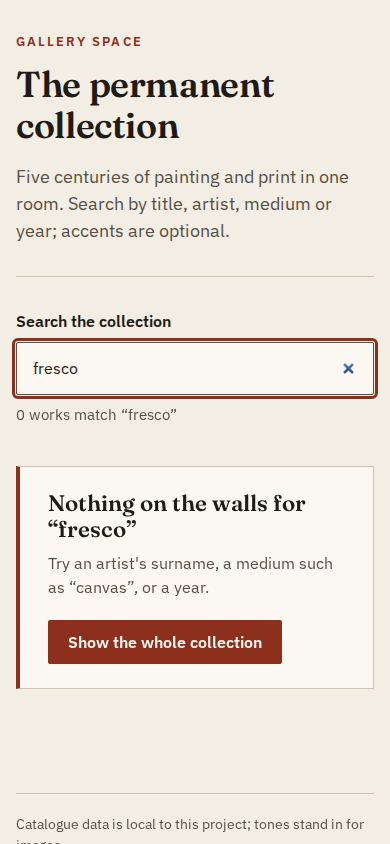
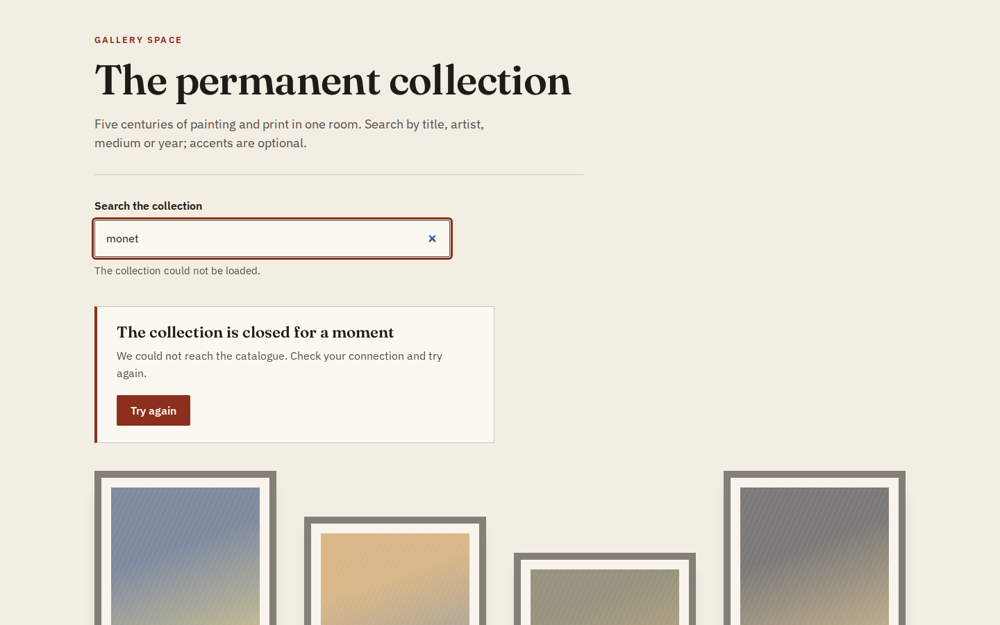
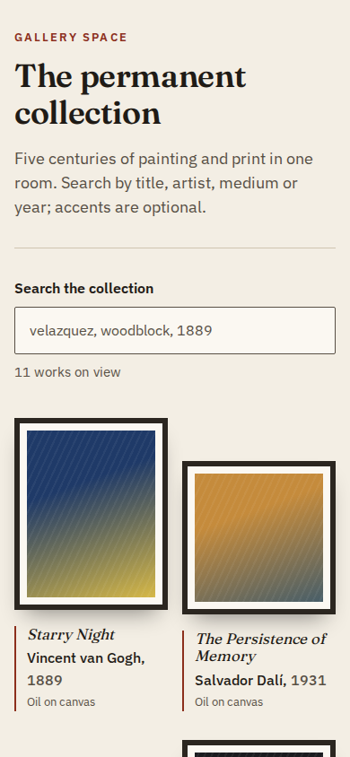

# Gallery Space

A small Next.js gallery for browsing a permanent collection of eleven paintings and prints. Search by title, artist, medium or year. The search ignores accents and word order, so `velazquez 1656` finds *Las Meninas* by Diego Velázquez.

The catalogue is a typed local dataset, so there is no CMS, database or API key. Each work is drawn as a framed canvas in two of its dominant tones instead of a photograph, so the page loads nothing from image hosts.



## Running it

You need Node 22 (`.nvmrc` pins it) and npm.

```bash
npm ci
npm run dev        # http://localhost:3000
```

Or run the production image, which needs only Docker:

```bash
docker build -t gallery-space .
docker run --rm -p 3000:3000 gallery-space
```

The image is built from Next's standalone output, runs as the unprivileged `node` user and has a healthcheck against the API. The app reads no environment variables of its own, so there is no `.env` file to create. `PORT` and `HOSTNAME` work as usual for `next start`.

| Script | What it does |
| --- | --- |
| `npm run dev` | Development server |
| `npm run build` / `npm start` | Production build and server |
| `npm test` | Jest: filter, API and component tests |
| `npm run lint` | ESLint 9 flat config with Next's core-web-vitals and TypeScript rules |
| `npm run typecheck` | Generates Next's route types, then runs `tsc --noEmit` |

## How it fits together



- `lib/artworkFilters.ts` is the only place query input is interpreted, and both the API and the tests go through it.
  - `normalizeQuery` folds accents (NFD) and case, and treats commas and semicolons as spaces.
  - `matchArtworks` requires every word to appear somewhere in the title, artist, medium or year.
  - `normalizeLimit` accepts only plain decimal numbers. Anything that is not a positive number becomes the default of 10, so hex, exponents, `NaN`, negatives and `0.5` all fall back. Larger values are floored and capped at 50.
- Repeated parameters (`?search=a&search=b`) use the first value.
- The route answers `GET` and `HEAD`, and every other method gets `405` with `Allow: GET, HEAD`.
- `useArtworkSearch` keeps the previous results on screen, dimmed, while the next request is in flight, so the wall never flashes empty between keystrokes.

## API

`GET /api/artworks`

| Parameter | Meaning |
| --- | --- |
| `search` | Words to match against title, artist, medium and year. Accents and case are ignored. |
| `limit` | Page size, default `10`, maximum `50` |

`total` is the number of matches before the limit is applied. These responses were captured from the Docker image:

```console
$ curl 'http://localhost:3000/api/artworks?search=dali'
{"data":[{"id":2,"title":"The Persistence of Memory","artist":"Salvador Dalí","year":1931,"medium":"Oil on canvas","tones":["#c58b3c","#3d5a6c"]}],"total":1,"returned":1}

$ curl 'http://localhost:3000/api/artworks?search=velazquez,%201656&limit=0.5'
{"data":[{"id":6,"title":"Las Meninas","artist":"Diego Velázquez","year":1656,"medium":"Oil on canvas","tones":["#3b2f26","#b39a76"]}],"total":1,"returned":1}

$ curl -i -X POST http://localhost:3000/api/artworks
HTTP/1.1 405 Method Not Allowed
Allow: GET, HEAD
{"error":"Method Not Allowed"}
```

## Interface

The page is set in Fraunces and IBM Plex Sans on a plaster and oxblood palette, with a dark scheme that follows the system setting. Works hang in mixed aspect ratios with wall-label captions. On phones the wall drops to two columns.

The search field is a labelled `role="search"` form with a polite live status line. Loading shows placeholder frames and sets `aria-busy`. An empty search explains what to try and offers a reset. A failed request raises an alert with a retry button.

| Narrowed search | Nothing found (phone) | Request failed |
| --- | --- | --- |
|  |  |  |



## Tests

There are 35 Jest tests, run through `next/jest`:

- `__tests__/lib`: query and limit normalisation, accent folding, multi-word matching.
- `__tests__/api`: status codes, the `Allow` header, invalid limits and repeated parameters, using `node-mocks-http`.
- `__tests__/components`: Testing Library in jsdom with `fetch` mocked. The tests cover the first load, a single debounced request while typing, the empty state and its reset, the error state and retry, and the pending state.

## Stack

Next.js 16 (pages router), React 19, TypeScript 5.9, Jest 30 and ESLint 9.

## Licence

MIT. See [LICENSE](LICENSE).
